# Scitizia: 63 low poly buildings, shops, street props and service park props in glTF/GLB with a retro 64-bit look

🇬🇧 English · **🇧🇷 [Leia em português](README.md)**


**Scitizia: 64-bit town** is a free collection of low poly buildings and town objects with the retro look of 64-bit consoles, ready for real-time games: **11 full city blocks** (team garage, five car dealerships of made-up brands, used car warehouse, used car lot, federation headquarters, museum and road gantry), **19 lots** with buildings, houses, two-storey houses, shops, warehouses, a parking lot and an empty lot, **5 street props** and **28 rally service park and stage props** (tents, service truck, motorhome, pickup, tools, grandstand with and without spectators, observation tower, team trailer and tow truck). There are 63 binary glTF 2.0 files (`.glb`) from 9.2 to 1,434.3 KB, with 42 to 10,902 triangles, vertex colors with baked shading and 64×64 px textures. The models are the same ones used in the career mode town of the game **Scitizia Rally Championship**, assembled by the game's own code; the dealership brands are made up.

## Summary

| | |
|---|---|
| Models | 63: town blocks (11) · buildings, houses and shops (19) · street (5) · service park (28) |
| Format | binary glTF 2.0 (`.glb`), textures also as PNG |
| Triangles | 42 to 10,902 per model (average 1,255) |
| Size | 9.2 to 1,434.3 KB per file, with the textures embedded |
| Materials | vertex color with baked shading; 9 grayscale 64×64 px textures (canvas, metal, wood...) and the signs with text |
| Scale and axes | meters, Y up, front facing +Z, origin on the ground |
| Machine-readable catalog | [`catalogo.json`](catalogo.json) |
| License | public domain, [CC0 1.0](LICENSE) |

## Town blocks

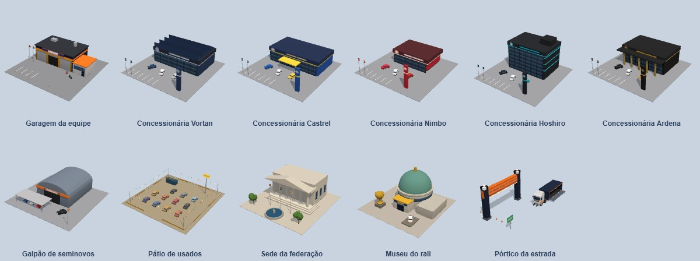

Full 36 × 36 m city blocks, with the lot (sidewalk 28 cm above the ground), the building, the yard, the signs and the cars on display: the front faces +Z, toward the street. The dealerships belong to the game's five made-up brands, each with its own building style and its logo on the totem.

| Preview | Model | Description | Triangles | Dimensions | Size |
|---|---|---|---|---|---|
| 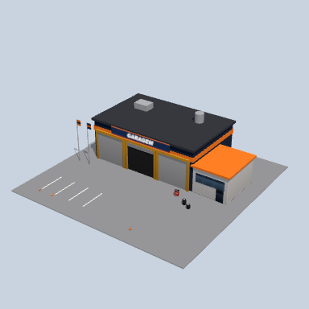 | **Team garage**<br>[`garagem_da_equipe.glb`](modelos/garagem_da_equipe.glb) | Navy blue warehouse with three doors (the middle one open and lit), office, tire stacks, cones and flags | 3,642 | 36.0 m × 10.4 m × 36.0 m | 491.3 KB |
| 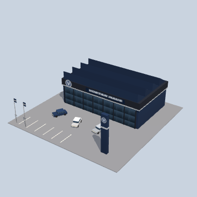 | **Vortan dealership**<br>[`concessionaria_vortan.glb`](modelos/concessionaria_vortan.glb) | Car showroom of the made-up brand Vortan (sawtooth roof), display window, totem with the logo, cars on display in the yard and flags | 1,792 | 36.0 m × 11.3 m × 36.0 m | 261.9 KB |
| 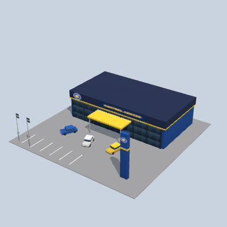 | **Castrel dealership**<br>[`concessionaria_castrel.glb`](modelos/concessionaria_castrel.glb) | Car showroom of the made-up brand Castrel (flat canopy), display window, totem with the logo, cars on display in the yard and flags | 1,724 | 36.0 m × 11.3 m × 36.0 m | 248.8 KB |
| 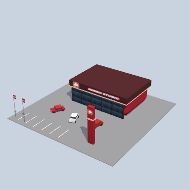 | **Nimbo dealership**<br>[`concessionaria_nimbo.glb`](modelos/concessionaria_nimbo.glb) | Car showroom of the made-up brand Nimbo (rounded corners), display window, totem with the logo, cars on display in the yard and flags | 2,120 | 36.0 m × 11.3 m × 36.0 m | 298.7 KB |
| 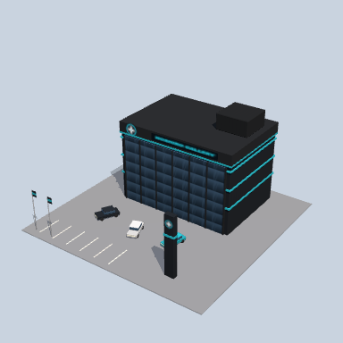 | **Hoshiro dealership**<br>[`concessionaria_hoshiro.glb`](modelos/concessionaria_hoshiro.glb) | Car showroom of the made-up brand Hoshiro (glass tower), display window, totem with the logo, cars on display in the yard and flags | 1,796 | 36.0 m × 18.3 m × 36.0 m | 260.2 KB |
| 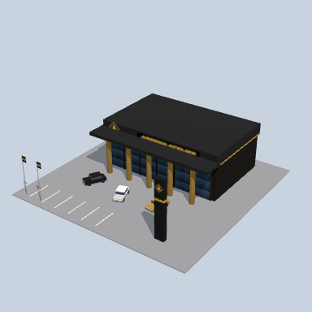 | **Ardena dealership**<br>[`concessionaria_ardena.glb`](modelos/concessionaria_ardena.glb) | Car showroom of the made-up brand Ardena (golden colonnade), display window, totem with the logo, cars on display in the yard and flags | 1,864 | 36.0 m × 11.3 m × 36.0 m | 263.6 KB |
| 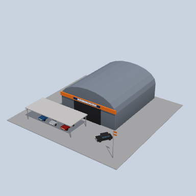 | **Used car warehouse**<br>[`galpao_de_seminovos.glb`](modelos/galpao_de_seminovos.glb) | Arched warehouse with a car canopy in front | 2,146 | 36.0 m × 9.9 m × 36.0 m | 297.0 KB |
| 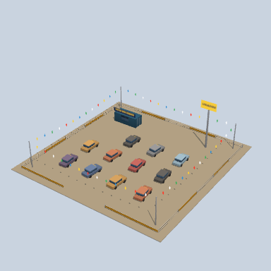 | **Used car lot**<br>[`patio_de_usados.glb`](modelos/patio_de_usados.glb) | Fenced lot with cars in rows, price tags, container office and a string of pennants | 5,844 | 36.0 m × 11.4 m × 36.0 m | 777.6 KB |
| 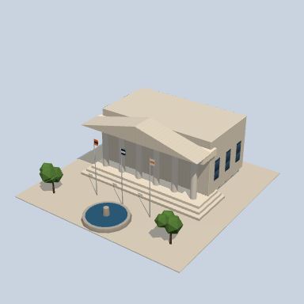 | **Federation headquarters**<br>[`sede_da_federacao.glb`](modelos/sede_da_federacao.glb) | Colonnaded building with a pediment, staircase, flagpoles and fountain | 1,038 | 36.0 m × 14.5 m × 36.0 m | 147.2 KB |
| 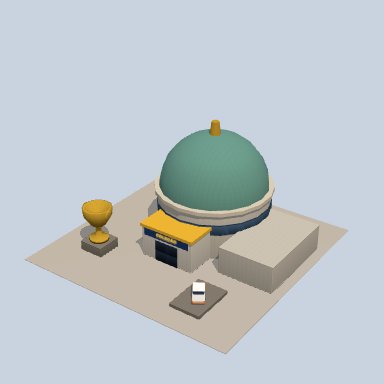 | **Rally museum**<br>[`museu_do_rali.glb`](modelos/museu_do_rali.glb) | Rotunda with a copper dome, gallery, giant trophy and a classic car on a pedestal | 1,620 | 36.0 m × 18.7 m × 36.0 m | 222.2 KB |
| 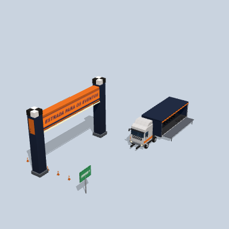 | **Road gantry**<br>[`portico_da_estrada.glb`](modelos/portico_da_estrada.glb) | Gantry over the road with signs, cones and the team truck | 10,902 | 15.9 m × 10.8 m × 31.1 m | 1,434.3 KB |

## Buildings, houses and shops

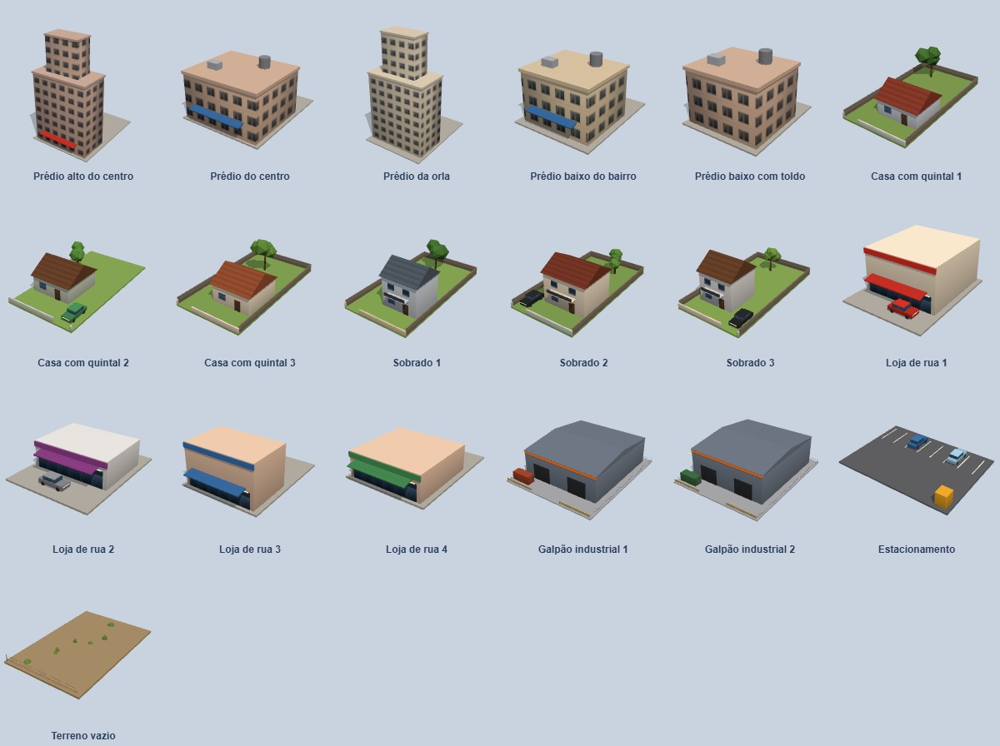

Town lots with the lot platform (top at y = 0) and what stands on it, drawn by the same generator as the game with fixed seeds: buildings with the window facade repeated every 3 m, houses and two-storey houses with wall, fence, yard and tree, shops with display window and awning, warehouses with a fenced yard.

| Preview | Model | Description | Triangles | Dimensions | Size |
|---|---|---|---|---|---|
| 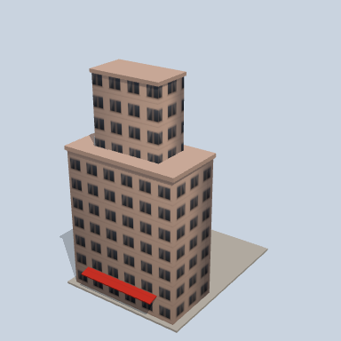 | **Downtown high-rise**<br>[`predio_centro_alto.glb`](modelos/predio_centro_alto.glb) | Many-storey building with a window facade, machine room and a setback at the top | 76 | 20.0 m × 33.2 m × 26.9 m | 20.5 KB |
| 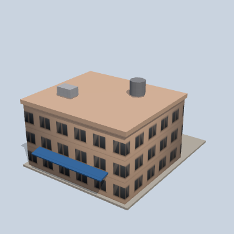 | **Downtown building**<br>[`predio_centro.glb`](modelos/predio_centro.glb) | Low-rise office building with a colorful awning on the ground floor | 88 | 18.0 m × 12.5 m × 23.1 m | 21.9 KB |
| 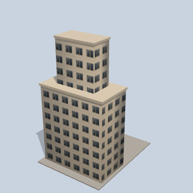 | **Seafront building**<br>[`predio_orla.glb`](modelos/predio_orla.glb) | Residential building set back from the sidewalk | 96 | 20.0 m × 34.4 m × 26.0 m | 19.5 KB |
| 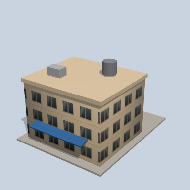 | **Low neighborhood building**<br>[`predio_bairro.glb`](modelos/predio_bairro.glb) | Building of two to four storeys | 88 | 16.0 m × 12.5 m × 20.1 m | 21.9 KB |
| 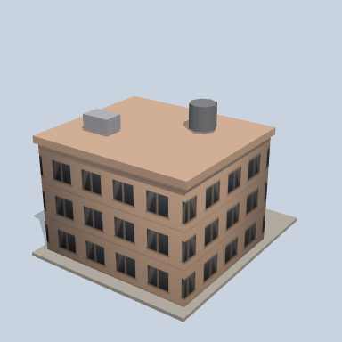 | **Low building with awning**<br>[`predio_bairro_toldo.glb`](modelos/predio_bairro_toldo.glb) | Small building with an awning and a water tank on the roof | 76 | 15.0 m × 12.5 m × 18.0 m | 16.9 KB |
| 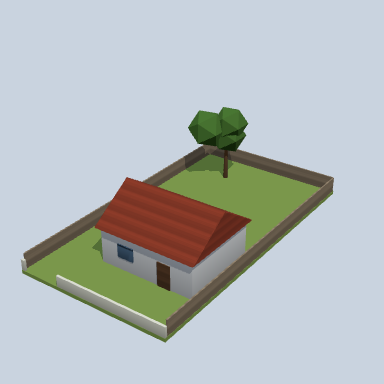 | **House with yard 1**<br>[`casa_1.glb`](modelos/casa_1.glb) | Single-storey house with a gable roof, low wall, wooden fence, tree and sometimes a car in the garage | 232 | 13.0 m × 6.9 m × 24.0 m | 38.4 KB |
| 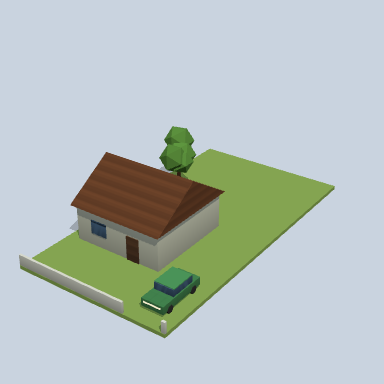 | **House with yard 2**<br>[`casa_2.glb`](modelos/casa_2.glb) | Single-storey house with a gable roof, low wall, wooden fence, tree and sometimes a car in the garage | 340 | 13.0 m × 6.0 m × 24.0 m | 55.6 KB |
| 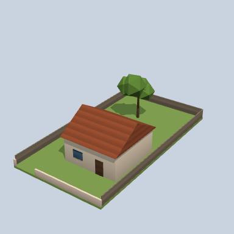 | **House with yard 3**<br>[`casa_3.glb`](modelos/casa_3.glb) | Single-storey house with a gable roof, low wall, wooden fence, tree and sometimes a car in the garage | 232 | 13.0 m × 7.2 m × 24.0 m | 38.4 KB |
| 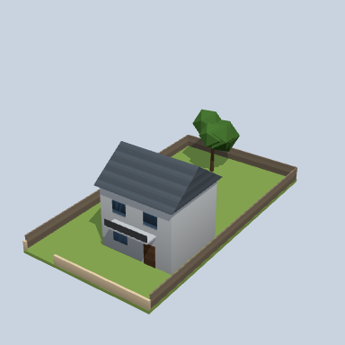 | **Two-storey house 1**<br>[`sobrado_1.glb`](modelos/sobrado_1.glb) | Two-storey house with a balcony, gable roof, wall and yard | 280 | 13.0 m × 8.6 m × 24.0 m | 46.7 KB |
| 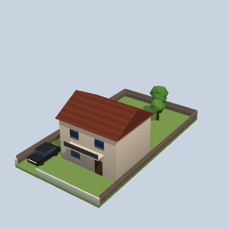 | **Two-storey house 2**<br>[`sobrado_2.glb`](modelos/sobrado_2.glb) | Two-storey house with a balcony, gable roof, wall and yard | 424 | 13.0 m × 8.3 m × 24.0 m | 66.5 KB |
| 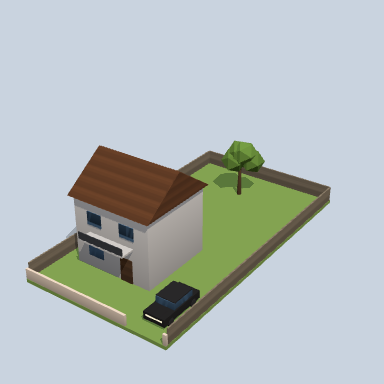 | **Two-storey house 3**<br>[`sobrado_3.glb`](modelos/sobrado_3.glb) | Two-storey house with a balcony, gable roof, wall and yard | 424 | 13.0 m × 8.7 m × 24.0 m | 66.4 KB |
| 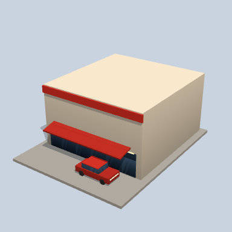 | **Street shop 1**<br>[`loja_1.glb`](modelos/loja_1.glb) | Shop with a display window, colored stripe, awning and a light on the facade | 216 | 14.0 m × 7.5 m × 18.0 m | 40.3 KB |
| 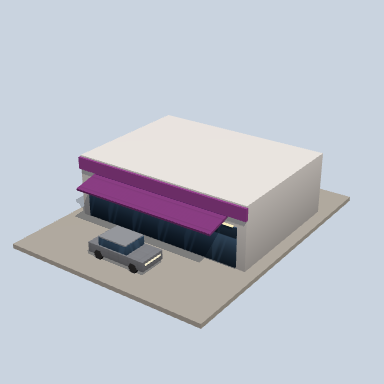 | **Street shop 2**<br>[`loja_2.glb`](modelos/loja_2.glb) | Shop with a display window, colored stripe, awning and a light on the facade | 216 | 14.0 m × 4.5 m × 18.0 m | 40.3 KB |
| 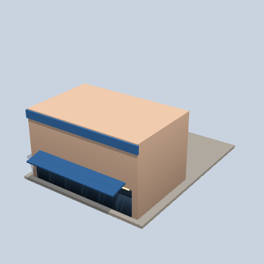 | **Street shop 3**<br>[`loja_3.glb`](modelos/loja_3.glb) | Shop with a display window, colored stripe, awning and a light on the facade | 72 | 14.0 m × 7.5 m × 19.3 m | 18.5 KB |
| 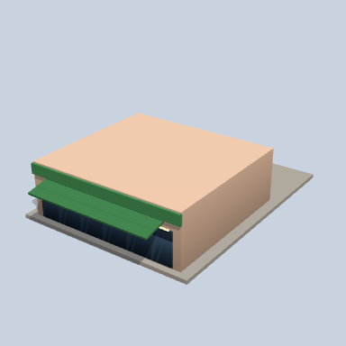 | **Street shop 4**<br>[`loja_4.glb`](modelos/loja_4.glb) | Shop with a display window, colored stripe, awning and a light on the facade | 72 | 14.0 m × 4.5 m × 19.3 m | 18.5 KB |
| 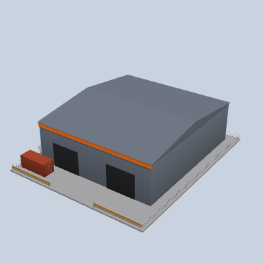 | **Industrial warehouse 1**<br>[`galpao_1.glb`](modelos/galpao_1.glb) | Sheet-metal warehouse with doors, fenced yard and container | 532 | 30.0 m × 10.5 m × 36.0 m | 77.1 KB |
| 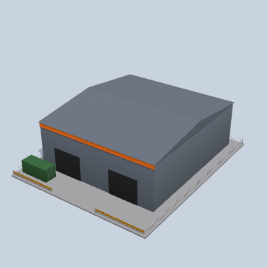 | **Industrial warehouse 2**<br>[`galpao_2.glb`](modelos/galpao_2.glb) | Sheet-metal warehouse with doors, fenced yard and container | 532 | 30.0 m × 11.5 m × 36.0 m | 77.1 KB |
| 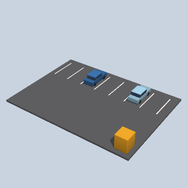 | **Parking lot**<br>[`estacionamento.glb`](modelos/estacionamento.glb) | Parking lot with painted spaces, cars and a booth | 504 | 22.0 m × 2.7 m × 16.0 m | 72.9 KB |
| 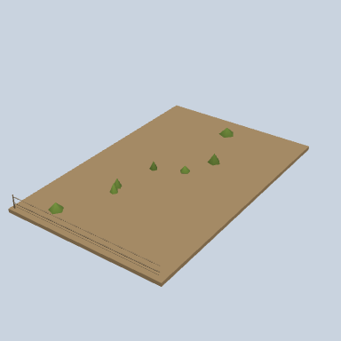 | **Empty lot**<br>[`terreno_vazio.glb`](modelos/terreno_vazio.glb) | Lot with weeds, a fence and a sign without text | 130 | 13.0 m × 1.4 m × 20.0 m | 20.2 KB |

## Street

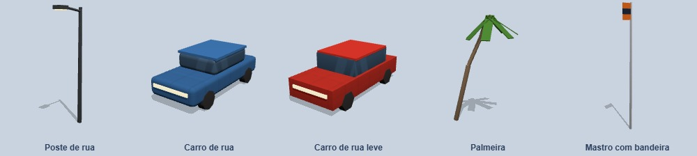

Loose pieces for streets and avenues.

| Preview | Model | Description | Triangles | Dimensions | Size |
|---|---|---|---|---|---|
| 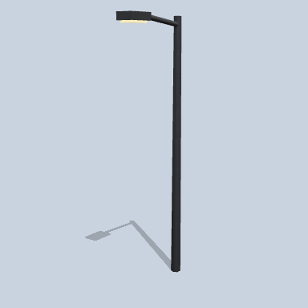 | **Street light**<br>[`poste_de_rua.glb`](modelos/poste_de_rua.glb) | Pole with an arm and a lit lamp | 60 | 40 cm × 6.5 m × 2.2 m | 12.6 KB |
| 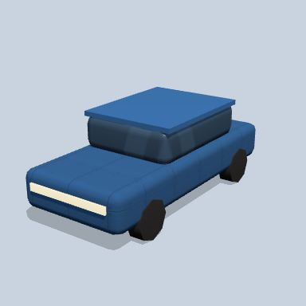 | **Street car**<br>[`carro_estacionado.glb`](modelos/carro_estacionado.glb) | Simple street car with a glass cabin and a headlight (vertex color) | 368 | 1.8 m × 1.5 m × 4.1 m | 55.5 KB |
| 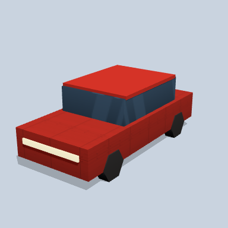 | **Light street car**<br>[`carro_estacionado_leve.glb`](modelos/carro_estacionado_leve.glb) | Lighter version of the street car, without bevels | 144 | 1.8 m × 1.5 m × 4.1 m | 26.6 KB |
| 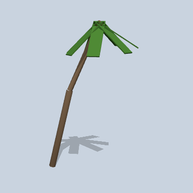 | **Palm tree**<br>[`palmeira.glb`](modelos/palmeira.glb) | Palm tree with a curved trunk in two segments | 128 | 4.9 m × 9.2 m × 4.3 m | 18.0 KB |
| 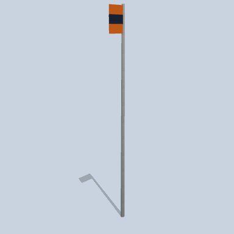 | **Flag pole**<br>[`mastro_com_bandeira.glb`](modelos/mastro_com_bandeira.glb) | Chrome pole with a two-color flag | 48 | 14 cm × 9.0 m × 1.0 m | 12.0 KB |

## Service park

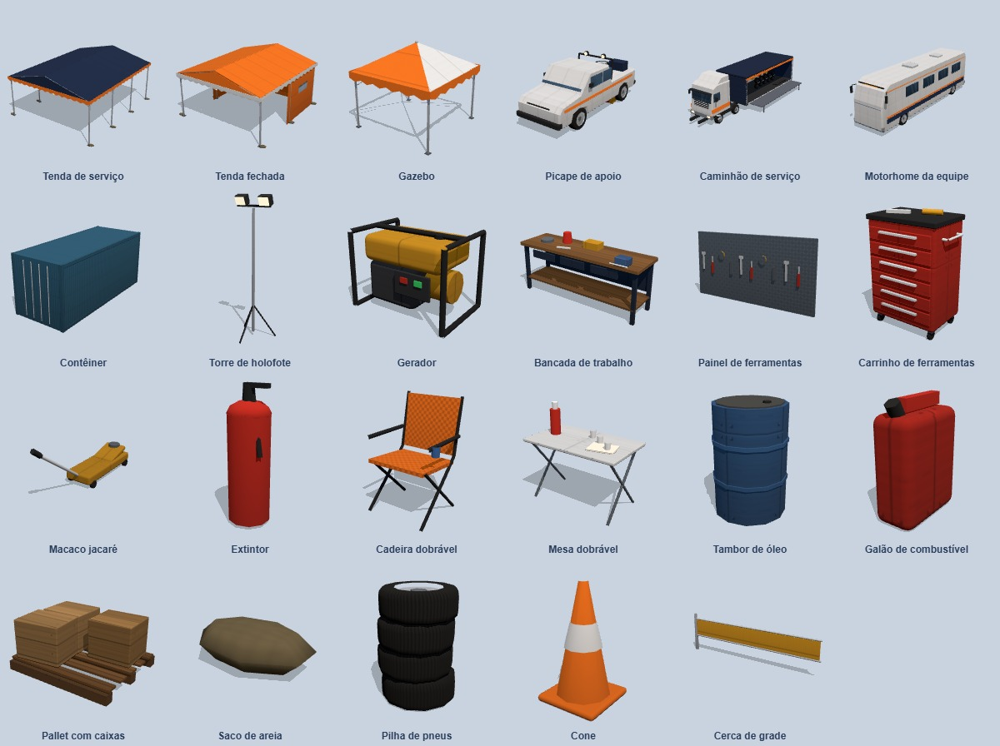

The game's service park kit: what the team sets up in a rally service park, plus the grandstand, observation tower, trailer and tow truck found at the start and finish of the stages.

| Preview | Model | Description | Triangles | Dimensions | Size |
|---|---|---|---|---|---|
| 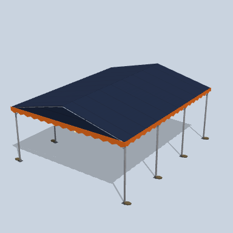 | **Service tent**<br>[`tenda_de_servico.glb`](modelos/tenda_de_servico.glb) | Tent with a tube frame, gable canvas roof, valance and a string of lights | 1,588 | 8.2 m × 4.4 m × 9.4 m | 213.1 KB |
| 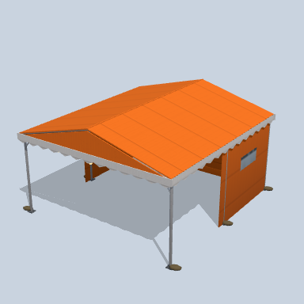 | **Closed tent**<br>[`tenda_fechada.glb`](modelos/tenda_fechada.glb) | Back tent with the canvas walls closed | 1,324 | 6.8 m × 3.9 m × 6.9 m | 182.2 KB |
| 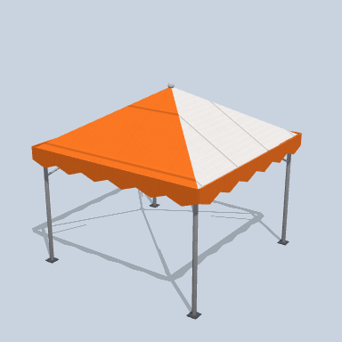 | **Gazebo**<br>[`gazebo.glb`](modelos/gazebo.glb) | Folding canvas gazebo in two colors | 548 | 3.7 m × 3.5 m × 3.7 m | 77.6 KB |
| 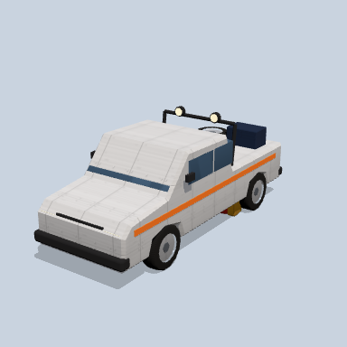 | **Support pickup**<br>[`picape_de_apoio.glb`](modelos/picape_de_apoio.glb) | Pickup with a roll bar, roof lights, spare tire and jerry cans in the bed | 2,968 | 2.1 m × 2.1 m × 5.3 m | 396.8 KB |
| 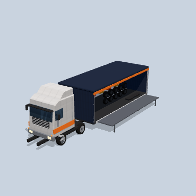 | **Service truck**<br>[`caminhao_de_servico.glb`](modelos/caminhao_de_servico.glb) | Truck with a box open on the side and a tractor unit | 9,460 | 5.8 m × 4.5 m × 16.0 m | 1,234.3 KB |
| 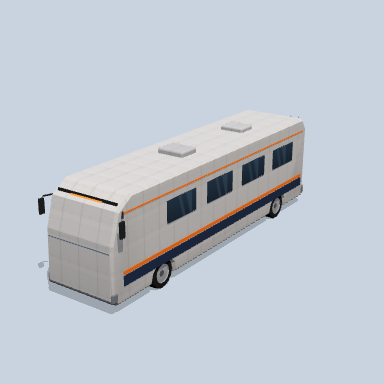 | **Team motorhome**<br>[`motorhome.glb`](modelos/motorhome.glb) | Motorhome with team stripes | 3,496 | 3.4 m × 3.7 m × 11.4 m | 463.6 KB |
| 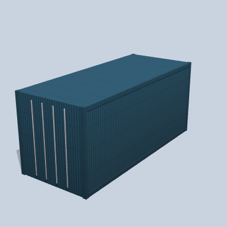 | **Container**<br>[`conteiner.glb`](modelos/conteiner.glb) | 6 m cargo container | 188 | 2.5 m × 2.6 m × 6.1 m | 29.5 KB |
| 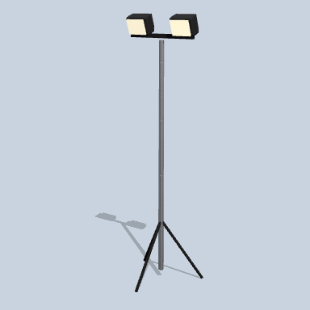 | **Floodlight tower**<br>[`holofote.glb`](modelos/holofote.glb) | Floodlight on a tripod with the lamp lit | 432 | 98 cm × 3.4 m × 86 cm | 60.6 KB |
| 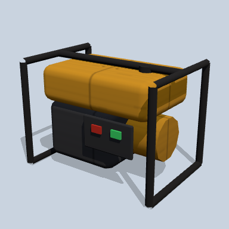 | **Generator**<br>[`gerador.glb`](modelos/gerador.glb) | Portable generator on wheels | 744 | 84 cm × 63 cm × 59 cm | 99.5 KB |
| 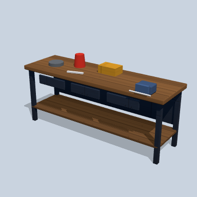 | **Workbench**<br>[`bancada.glb`](modelos/bancada.glb) | Workshop bench with drawers | 932 | 2.4 m × 1.2 m × 79 cm | 127.6 KB |
| 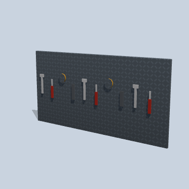 | **Tool board**<br>[`painel_de_ferramentas.glb`](modelos/painel_de_ferramentas.glb) | Wall board with hanging tools | 316 | 2.4 m × 1.2 m × 7 cm | 45.3 KB |
|  | **Tool cart**<br>[`caixa_de_ferramentas.glb`](modelos/caixa_de_ferramentas.glb) | Tall tool cart with drawers | 1,232 | 79 cm × 1.1 m × 53 cm | 162.4 KB |
|  | **Floor jack**<br>[`macaco_jacare.glb`](modelos/macaco_jacare.glb) | Hydraulic workshop jack | 420 | 38 cm × 74 cm × 1.7 m | 57.7 KB |
|  | **Fire extinguisher**<br>[`extintor.glb`](modelos/extintor.glb) | Fire extinguisher | 208 | 21 cm × 65 cm × 20 cm | 28.3 KB |
|  | **Folding chair**<br>[`cadeira_dobravel.glb`](modelos/cadeira_dobravel.glb) | Folding canvas chair | 136 | 63 cm × 93 cm × 59 cm | 22.0 KB |
|  | **Folding table**<br>[`mesa_dobravel.glb`](modelos/mesa_dobravel.glb) | Light support table | 376 | 1.2 m × 1.1 m × 70 cm | 52.0 KB |
|  | **Oil drum**<br>[`tambor.glb`](modelos/tambor.glb) | 200-liter metal drum | 216 | 60 cm × 91 cm × 60 cm | 31.4 KB |
|  | **Fuel jerry can**<br>[`galao.glb`](modelos/galao.glb) | Fuel jerry can | 336 | 18 cm × 50 cm × 34 cm | 46.9 KB |
|  | **Pallet with boxes**<br>[`pallet_com_caixas.glb`](modelos/pallet_com_caixas.glb) | Wooden pallet with cardboard boxes | 420 | 1.2 m × 56 cm × 1.0 m | 58.4 KB |
|  | **Sandbag**<br>[`saco_de_areia.glb`](modelos/saco_de_areia.glb) | Ballast sandbag | 42 | 40 cm × 14 cm × 25 cm | 9.2 KB |
|  | **Tire stack**<br>[`pilha_de_pneus.glb`](modelos/pilha_de_pneus.glb) | Stack of four tires | 744 | 69 cm × 98 cm × 66 cm | 101.5 KB |
|  | **Cone**<br>[`cone.glb`](modelos/cone.glb) | Traffic cone | 148 | 36 cm × 64 cm × 36 cm | 20.5 KB |
|  | **Barrier fence**<br>[`cerca_de_grade.glb`](modelos/cerca_de_grade.glb) | Section of barrier fence with a yellow stripe | 60 | 4.0 m × 1.1 m × 10 cm | 14.8 KB |
|  | **Grandstand**<br>[`arquibancada.glb`](modelos/arquibancada.glb) | Five-step grandstand with a tube frame, wooden benches, side stairs and a team banner | 1,144 | 11.2 m × 3.4 m × 4.8 m | 161.3 KB |
|  | **Grandstand with spectators**<br>[`arquibancada_com_publico.glb`](modelos/arquibancada_com_publico.glb) | The same grandstand with seated spectators (simple figures of ~100 triangles merged into the mesh) | 5,732 | 11.2 m × 3.7 m × 4.8 m | 752.8 KB |
|  | **Observation tower**<br>[`torre_de_observacao.glb`](modelos/torre_de_observacao.glb) | Lattice wooden tower with a platform, guardrail, hip roof and stairs | 1,342 | 3.7 m × 10.1 m × 4.0 m | 185.9 KB |
|  | **Support trailer**<br>[`trailer_de_apoio.glb`](modelos/trailer_de_apoio.glb) | Small team trailer with a box body, stripes, side door, tow bar and jockey wheel | 1,456 | 2.1 m × 2.7 m × 5.5 m | 197.6 KB |
|  | **Tow truck**<br>[`guincho.glb`](modelos/guincho.glb) | Support tow truck with a boom, cable and hook, tow fork, beacon light and tool boxes | 3,176 | 3.0 m × 3.5 m × 9.5 m | 422.3 KB |

## Folders

- `modelos/<id>.glb`: one model per file.
- `texturas/`: the kit's 9 textures of 64×64 px (the same ones embedded in the `.glb` files; the signs with text exist only inside the models).
- `previas/<id>.png`: three-quarter view of each model.
- `catalogo.json`: sections, models, descriptions, dimensions, triangles, materials and file paths.
- `docs/`: overall mosaic, section mosaics and the cover.

## How to use the models

- Meters, Y axis up, front facing +Z. The origin sits on the ground: at the center of the block for town blocks, at the center of the lot for buildings and houses, and at the center of the object for loose pieces.
- The colors are stored as vertex color (with the base darkened near the ground, like baked ambient light); the textures are gray and only add grain. Turn on vertex color in the material if your program does not do it by itself.
- The `luz` materials (lit windows, lamps, headlights) and `placa` are unlit: they glow the same by day and by night.
- The town blocks have signs with text in Portuguese ("MUSEU DO RALI", "SEMINOVOS"...): swap the `placa` texture to translate them.

Example in JavaScript, with the glTF loader of your 3D web library:

```js
const museu = (await carregadorGltf.loadAsync("modelos/museu_do_rali.glb")).scene;
museu.traverse((o) => { if (o.isMesh) o.material.vertexColors = true; });
cena.add(museu);
```

## Frequently asked questions

**What format are the models in?**
Binary glTF 2.0 (`.glb`), one file per model, with the mesh, materials and textures embedded. The kit's textures are also available as loose PNG files.

**Can I import them into any game engine or 3D program?**
Yes, into any engine, web library or 3D editor that reads glTF 2.0. The only extension used is the unlit material one, which every glTF reader knows.

**Do the dealership brands exist?**
No. The five brands, with their names, colors and logos, were made up for the game; none imitates a real manufacturer.

**Can I use them in a commercial game?**
Yes. The models are in the public domain (CC0 1.0): use, modify and redistribute them without asking for permission or giving credit. Credit is welcome (see [`CITATION.cff`](CITATION.cff)).

**How were they made?**
By code: each model is built from beveled boxes, cylinders, tubes and extruded profiles, with vertex color and 64 px textures drawn on a canvas, by the same code that draws the town and the service park in the game. Every file was exported, opened again and rendered to check it.

## Other collections from the same game

- [Rally car fleet](https://github.com/kayquer/scitizia-frota-64) · [Breakable props](https://github.com/kayquer/scitizia-props-64) · [People](https://github.com/kayquer/scitizia-pessoas-64) · [Wheels and tires](https://github.com/kayquer/scitizia-rodas-64) · [Car parts](https://github.com/kayquer/scitizia-pecas-64) · [Nature](https://github.com/kayquer/scitizia-natureza-64)

## License

[CC0 1.0 Universal](LICENSE): public domain.

## How to cite

The citation metadata is in [`CITATION.cff`](CITATION.cff).
