# Scitizia: 58 prédios, lojas, peças de rua e de parque de apoio low poly em glTF/GLB com visual retrô de 64 bits

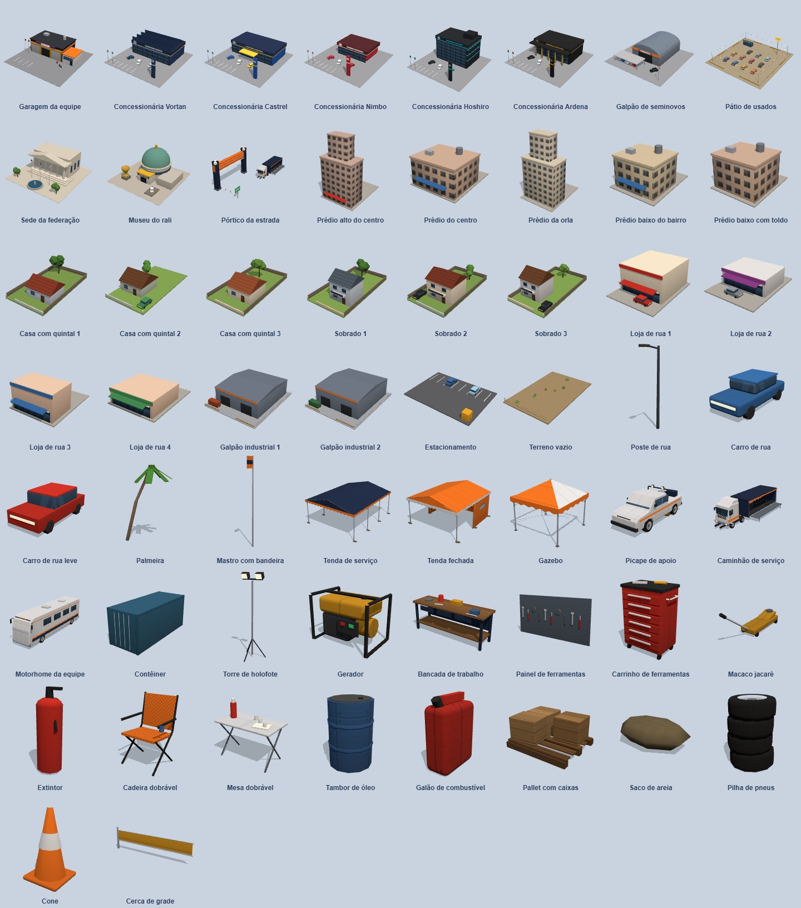

**Scitizia: cidade 64 bits** é uma coleção gratuita de construções e objetos de cidade em baixo polígono (low poly), com o visual retrô dos consoles de 64 bits, prontos para jogos em tempo real: **11 locais** inteiros num quarteirão (garagem da equipe, cinco concessionárias de marcas inventadas, galpão de seminovos, pátio de usados, sede da federação, museu e pórtico da estrada), **19 lotes** de prédios, casas, sobrados, lojas, galpões, estacionamento e terreno vazio, **5 peças de rua** e **23 objetos de parque de apoio** de equipe de rali (tendas, caminhão de serviço, motorhome, picape, ferramentas). São 58 arquivos glTF 2.0 binários (`.glb`) de 9,2 a 1.434,3 KB, com 42 a 10.902 triângulos, cor por vértice com sombreado assado e texturas de 64×64 px. Os modelos são os mesmos da cidade da carreira do jogo **Scitizia Rally Championship**, montados pelo próprio código do jogo; as marcas das concessionárias são inventadas.

**English summary:** Scitizia 64-bit town is a free pack of 58 low-poly town buildings and props with a retro 64-bit console look: 11 full city blocks (team garage, five car dealerships of made-up brands, used car lot, motor sport federation building, rally museum and a road gantry), 19 lots with office and apartment buildings, houses with gardens, two-storey houses, street shops, warehouses, a parking lot and an empty lot, 5 street props (street light, parked cars, palm tree, flag pole) and 23 rally service park props (service tents, gazebo, service truck, motorhome, support pickup, container, floodlight, generator, workbench, tool cabinet, jack, chairs, drums, cones). Every model is a binary glTF 2.0 (`.glb`) file with 42 to 10902 triangles, vertex colors with baked shading and small 64×64 textures. Units are meters, Y is up, the front faces +Z and the origin sits on the ground. Public domain (CC0 1.0).

## Resumo

| | |
|---|---|
| Modelos | 58: locais da cidade (11) · prédios, casas e lojas (19) · rua (5) · parque de apoio (23) |
| Formato | glTF 2.0 binário (`.glb`), texturas também em PNG |
| Triângulos | 42 a 10.902 por modelo (média 1.141) |
| Tamanho | 9,2 a 1.434,3 KB por arquivo, com as texturas embutidas |
| Materiais | cor por vértice com sombreado assado; 9 texturas de 64×64 px em tons de cinza (lona, metal, madeira...) e as placas com texto |
| Escala e eixos | metros, Y para cima, frente em +Z, origem no chão |
| Catálogo legível por máquina | [`catalogo.json`](catalogo.json) |
| Licença | domínio público, [CC0 1.0](LICENSE) |

## Locais da cidade

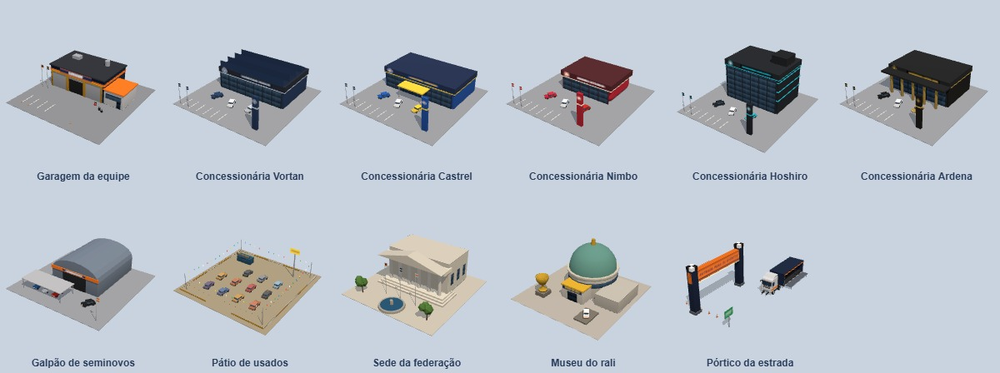

Quarteirões inteiros de 36 × 36 m, com o lote (calçada a 28 cm do chão), o prédio, o pátio, as placas e os carros expostos: a frente fica em +Z, virada para a rua. As concessionárias são das cinco marcas inventadas do jogo, cada uma com um estilo de prédio e o logotipo no totem.

| Prévia | Modelo | Descrição | Triângulos | Medidas | Tamanho |
|---|---|---|---|---|---|
| 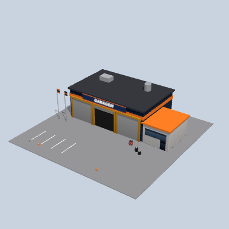 | **Garagem da equipe**<br>[`garagem_da_equipe.glb`](modelos/garagem_da_equipe.glb) | Galpão azul-marinho com três portões (o do meio aberto e iluminado), escritório, pilhas de pneus, cones e bandeiras | 3.642 | 36,0 m × 10,4 m × 36,0 m | 491,3 KB |
| 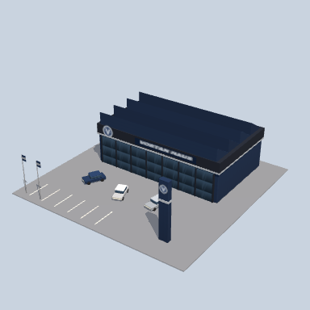 | **Concessionária Vortan**<br>[`concessionaria_vortan.glb`](modelos/concessionaria_vortan.glb) | Loja de carros da marca inventada Vortan (telhado em serra), vitrine, totem com o logotipo, carros expostos no pátio e bandeiras | 1.792 | 36,0 m × 11,3 m × 36,0 m | 261,9 KB |
| 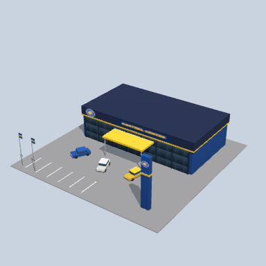 | **Concessionária Castrel**<br>[`concessionaria_castrel.glb`](modelos/concessionaria_castrel.glb) | Loja de carros da marca inventada Castrel (marquise reta), vitrine, totem com o logotipo, carros expostos no pátio e bandeiras | 1.724 | 36,0 m × 11,3 m × 36,0 m | 248,8 KB |
| 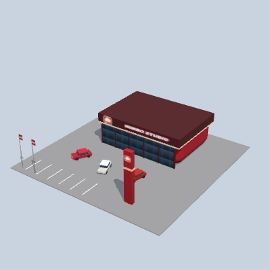 | **Concessionária Nimbo**<br>[`concessionaria_nimbo.glb`](modelos/concessionaria_nimbo.glb) | Loja de carros da marca inventada Nimbo (quinas arredondadas), vitrine, totem com o logotipo, carros expostos no pátio e bandeiras | 2.120 | 36,0 m × 11,3 m × 36,0 m | 298,7 KB |
| 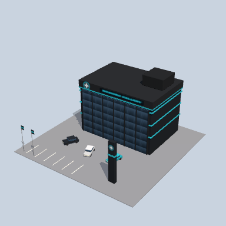 | **Concessionária Hoshiro**<br>[`concessionaria_hoshiro.glb`](modelos/concessionaria_hoshiro.glb) | Loja de carros da marca inventada Hoshiro (torre de vidro), vitrine, totem com o logotipo, carros expostos no pátio e bandeiras | 1.796 | 36,0 m × 18,3 m × 36,0 m | 260,2 KB |
| 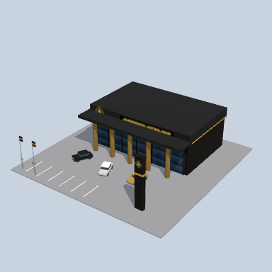 | **Concessionária Ardena**<br>[`concessionaria_ardena.glb`](modelos/concessionaria_ardena.glb) | Loja de carros da marca inventada Ardena (colunata dourada), vitrine, totem com o logotipo, carros expostos no pátio e bandeiras | 1.864 | 36,0 m × 11,3 m × 36,0 m | 263,6 KB |
| 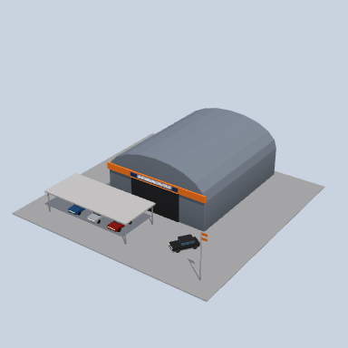 | **Galpão de seminovos**<br>[`galpao_de_seminovos.glb`](modelos/galpao_de_seminovos.glb) | Galpão em arco com cobertura de carros na frente | 2.146 | 36,0 m × 9,9 m × 36,0 m | 297,0 KB |
| 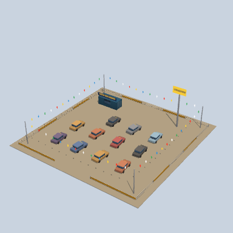 | **Pátio de usados**<br>[`patio_de_usados.glb`](modelos/patio_de_usados.glb) | Pátio cercado com carros em fileiras, etiquetas de preço, contêiner-escritório e varal de bandeirolas | 5.844 | 36,0 m × 11,4 m × 36,0 m | 777,6 KB |
| 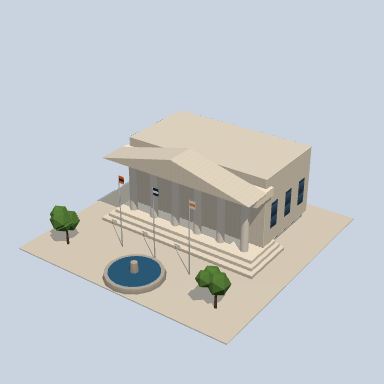 | **Sede da federação**<br>[`sede_da_federacao.glb`](modelos/sede_da_federacao.glb) | Prédio de colunata com frontão, escadaria, mastros e chafariz | 1.038 | 36,0 m × 14,5 m × 36,0 m | 147,2 KB |
| 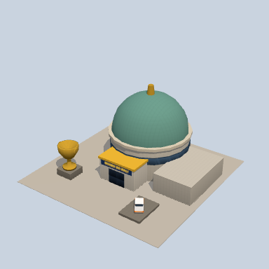 | **Museu do rali**<br>[`museu_do_rali.glb`](modelos/museu_do_rali.glb) | Rotunda com cúpula de cobre, galeria, troféu gigante e carro clássico no pedestal | 1.620 | 36,0 m × 18,7 m × 36,0 m | 223,2 KB |
| 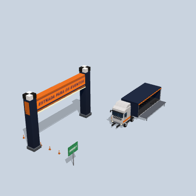 | **Pórtico da estrada**<br>[`portico_da_estrada.glb`](modelos/portico_da_estrada.glb) | Pórtico sobre a estrada com placas, cones e o caminhão da equipe | 10.902 | 15,9 m × 10,8 m × 31,1 m | 1.434,3 KB |

## Prédios, casas e lojas

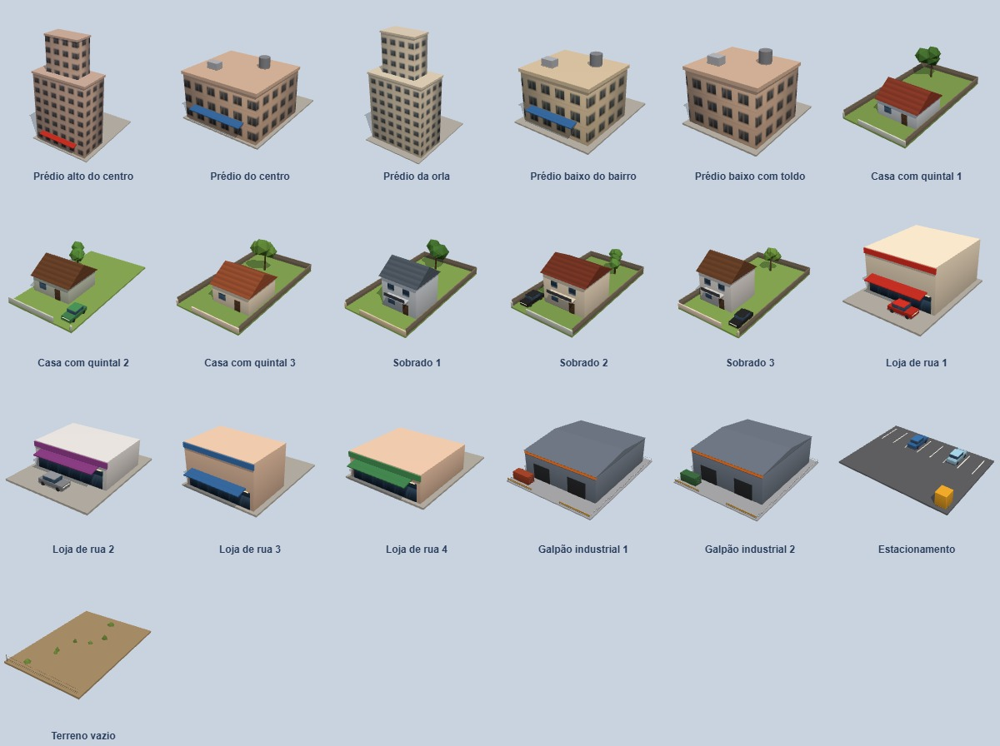

Lotes da cidade com o platô do lote (topo em y = 0) e o que está em cima, sorteados pelo mesmo gerador do jogo com sementes fixas: prédios com a fachada de janelas repetida a cada 3 m, casas e sobrados com muro, cerca, quintal e árvore, lojas com vitrine e toldo, galpões com pátio cercado.

| Prévia | Modelo | Descrição | Triângulos | Medidas | Tamanho |
|---|---|---|---|---|---|
| 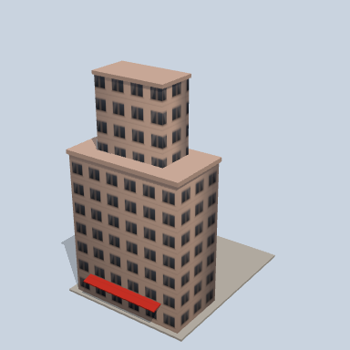 | **Prédio alto do centro**<br>[`predio_centro_alto.glb`](modelos/predio_centro_alto.glb) | Prédio de muitos andares com fachada de janelas, casa de máquinas e recuo no topo | 76 | 20,0 m × 33,2 m × 26,9 m | 20,5 KB |
| 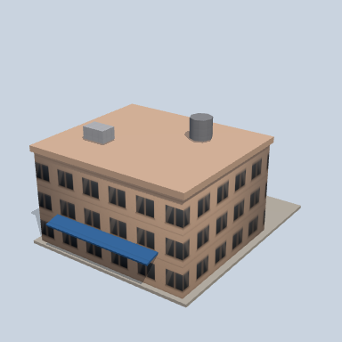 | **Prédio do centro**<br>[`predio_centro.glb`](modelos/predio_centro.glb) | Prédio de escritórios de poucos andares com toldo colorido no térreo | 88 | 18,0 m × 12,5 m × 23,1 m | 21,9 KB |
| 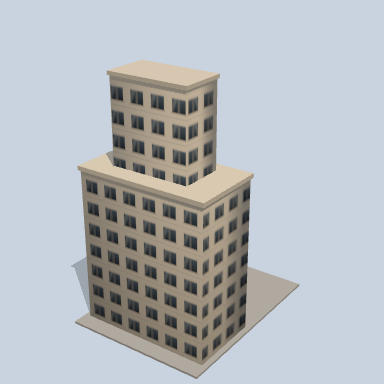 | **Prédio da orla**<br>[`predio_orla.glb`](modelos/predio_orla.glb) | Prédio residencial recuado da calçada | 96 | 20,0 m × 34,4 m × 26,0 m | 19,5 KB |
| 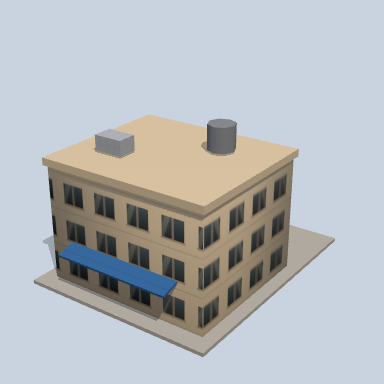 | **Prédio baixo do bairro**<br>[`predio_bairro.glb`](modelos/predio_bairro.glb) | Prédio de dois a quatro andares | 88 | 16,0 m × 12,5 m × 20,1 m | 21,9 KB |
| 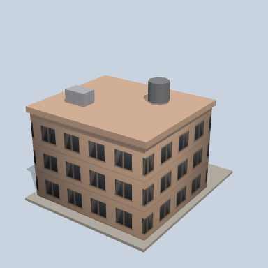 | **Prédio baixo com toldo**<br>[`predio_bairro_toldo.glb`](modelos/predio_bairro_toldo.glb) | Prédio pequeno com toldo e caixa-d'água no telhado | 76 | 15,0 m × 12,5 m × 18,0 m | 16,9 KB |
| 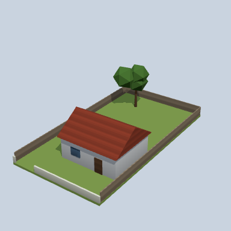 | **Casa com quintal 1**<br>[`casa_1.glb`](modelos/casa_1.glb) | Casa térrea com telhado de duas águas, muro baixo, cerca de madeira, árvore e às vezes carro na garagem | 232 | 13,0 m × 6,9 m × 24,0 m | 38,4 KB |
| 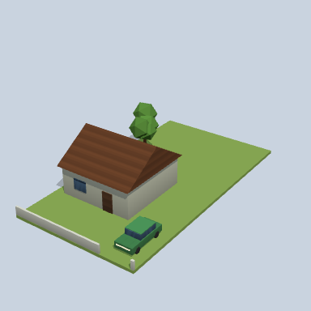 | **Casa com quintal 2**<br>[`casa_2.glb`](modelos/casa_2.glb) | Casa térrea com telhado de duas águas, muro baixo, cerca de madeira, árvore e às vezes carro na garagem | 340 | 13,0 m × 6,0 m × 24,0 m | 55,6 KB |
| 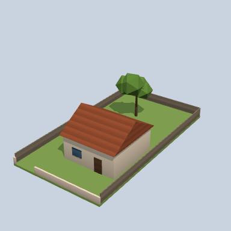 | **Casa com quintal 3**<br>[`casa_3.glb`](modelos/casa_3.glb) | Casa térrea com telhado de duas águas, muro baixo, cerca de madeira, árvore e às vezes carro na garagem | 232 | 13,0 m × 7,2 m × 24,0 m | 38,4 KB |
| 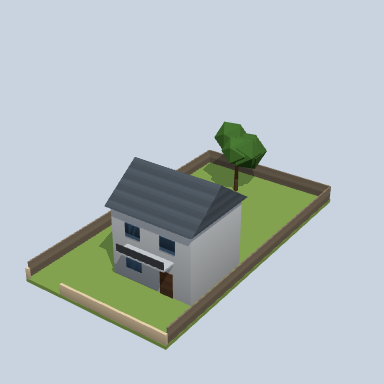 | **Sobrado 1**<br>[`sobrado_1.glb`](modelos/sobrado_1.glb) | Sobrado com sacada, telhado de duas águas, muro e quintal | 280 | 13,0 m × 8,6 m × 24,0 m | 46,7 KB |
| 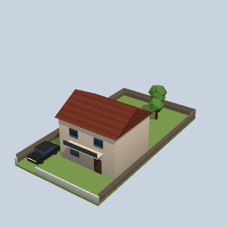 | **Sobrado 2**<br>[`sobrado_2.glb`](modelos/sobrado_2.glb) | Sobrado com sacada, telhado de duas águas, muro e quintal | 424 | 13,0 m × 8,3 m × 24,0 m | 66,5 KB |
| 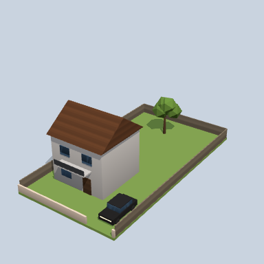 | **Sobrado 3**<br>[`sobrado_3.glb`](modelos/sobrado_3.glb) | Sobrado com sacada, telhado de duas águas, muro e quintal | 424 | 13,0 m × 8,7 m × 24,0 m | 66,4 KB |
| 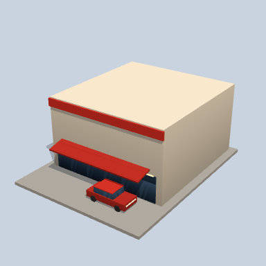 | **Loja de rua 1**<br>[`loja_1.glb`](modelos/loja_1.glb) | Loja com vitrine, faixa colorida, toldo e luz na fachada | 216 | 14,0 m × 7,5 m × 18,0 m | 40,3 KB |
| 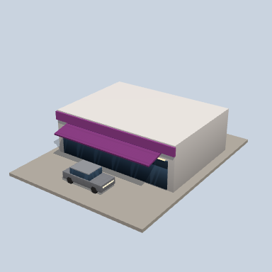 | **Loja de rua 2**<br>[`loja_2.glb`](modelos/loja_2.glb) | Loja com vitrine, faixa colorida, toldo e luz na fachada | 216 | 14,0 m × 4,5 m × 18,0 m | 40,3 KB |
| 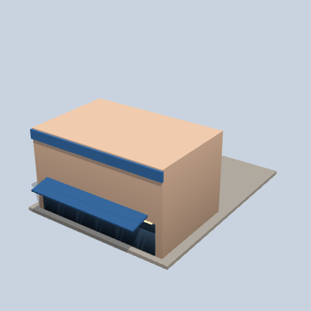 | **Loja de rua 3**<br>[`loja_3.glb`](modelos/loja_3.glb) | Loja com vitrine, faixa colorida, toldo e luz na fachada | 72 | 14,0 m × 7,5 m × 19,3 m | 18,5 KB |
| 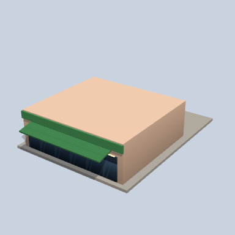 | **Loja de rua 4**<br>[`loja_4.glb`](modelos/loja_4.glb) | Loja com vitrine, faixa colorida, toldo e luz na fachada | 72 | 14,0 m × 4,5 m × 19,3 m | 18,5 KB |
| 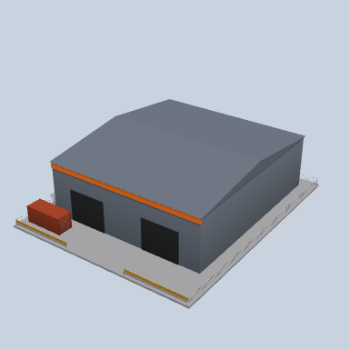 | **Galpão industrial 1**<br>[`galpao_1.glb`](modelos/galpao_1.glb) | Galpão de chapa com portões, pátio cercado e contêiner | 532 | 30,0 m × 10,5 m × 36,0 m | 77,1 KB |
| 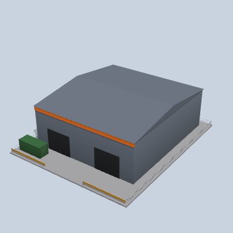 | **Galpão industrial 2**<br>[`galpao_2.glb`](modelos/galpao_2.glb) | Galpão de chapa com portões, pátio cercado e contêiner | 532 | 30,0 m × 11,5 m × 36,0 m | 77,1 KB |
| 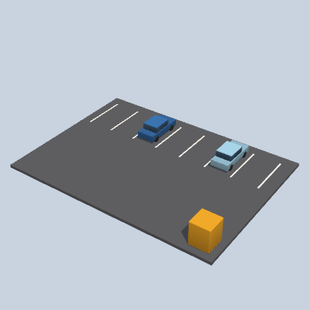 | **Estacionamento**<br>[`estacionamento.glb`](modelos/estacionamento.glb) | Lote de estacionamento com vagas pintadas, carros e guarita | 504 | 22,0 m × 2,7 m × 16,0 m | 72,9 KB |
| 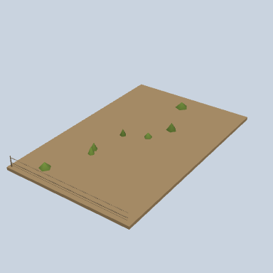 | **Terreno vazio**<br>[`terreno_vazio.glb`](modelos/terreno_vazio.glb) | Terreno com mato, cerca e placa sem texto | 130 | 13,0 m × 1,4 m × 20,0 m | 20,2 KB |

## Rua

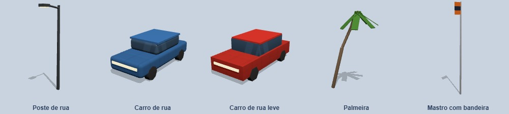

Peças soltas para ruas e avenidas.

| Prévia | Modelo | Descrição | Triângulos | Medidas | Tamanho |
|---|---|---|---|---|---|
| 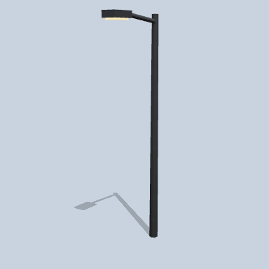 | **Poste de rua**<br>[`poste_de_rua.glb`](modelos/poste_de_rua.glb) | Poste com braço e luminária acesa | 60 | 40 cm × 6,5 m × 2,2 m | 12,6 KB |
| 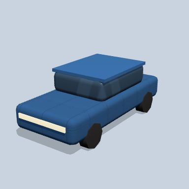 | **Carro de rua**<br>[`carro_estacionado.glb`](modelos/carro_estacionado.glb) | Carro simples de rua com cabine de vidro e farol (cor por vértice) | 368 | 1,8 m × 1,5 m × 4,1 m | 55,5 KB |
| 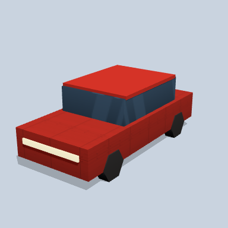 | **Carro de rua leve**<br>[`carro_estacionado_leve.glb`](modelos/carro_estacionado_leve.glb) | Versão mais leve do carro de rua, sem chanfro | 144 | 1,8 m × 1,5 m × 4,1 m | 26,6 KB |
| 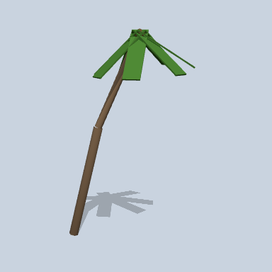 | **Palmeira**<br>[`palmeira.glb`](modelos/palmeira.glb) | Palmeira de tronco curvo em dois gomos | 128 | 4,9 m × 9,2 m × 4,3 m | 18,0 KB |
| 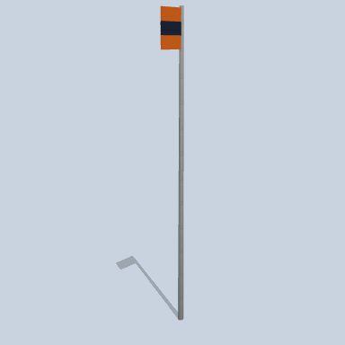 | **Mastro com bandeira**<br>[`mastro_com_bandeira.glb`](modelos/mastro_com_bandeira.glb) | Mastro cromado com bandeira de duas cores | 48 | 14 cm × 9,0 m × 1,0 m | 12,0 KB |

## Parque de apoio

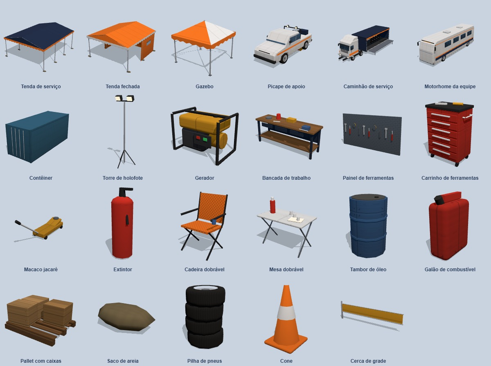

O kit dos parques de apoio do jogo: o que a equipe monta no parque de serviço de um rali.

| Prévia | Modelo | Descrição | Triângulos | Medidas | Tamanho |
|---|---|---|---|---|---|
| 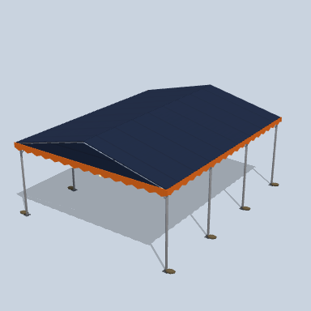 | **Tenda de serviço**<br>[`tenda_de_servico.glb`](modelos/tenda_de_servico.glb) | Tenda com estrutura de tubos, teto de lona em duas águas, babado e varal de lâmpadas | 1.588 | 8,2 m × 4,4 m × 9,4 m | 213,1 KB |
| 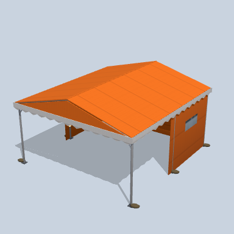 | **Tenda fechada**<br>[`tenda_fechada.glb`](modelos/tenda_fechada.glb) | Tenda de fundo com as paredes de lona fechadas | 1.324 | 6,8 m × 3,9 m × 6,9 m | 182,2 KB |
| 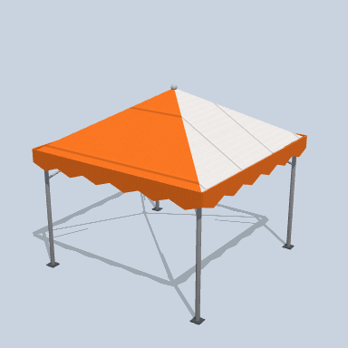 | **Gazebo**<br>[`gazebo.glb`](modelos/gazebo.glb) | Gazebo dobrável de lona em duas cores | 548 | 3,7 m × 3,5 m × 3,7 m | 77,6 KB |
| 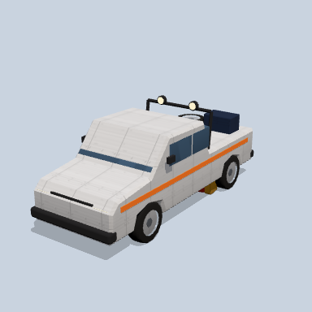 | **Picape de apoio**<br>[`picape_de_apoio.glb`](modelos/picape_de_apoio.glb) | Picape com santo-antônio, faróis de teto, estepe e galões na caçamba | 2.968 | 2,1 m × 2,1 m × 5,3 m | 396,8 KB |
| 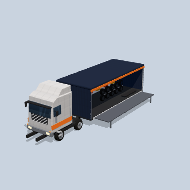 | **Caminhão de serviço**<br>[`caminhao_de_servico.glb`](modelos/caminhao_de_servico.glb) | Caminhão com baú aberto de lado e cavalo mecânico | 9.460 | 5,8 m × 4,5 m × 16,0 m | 1.234,3 KB |
| 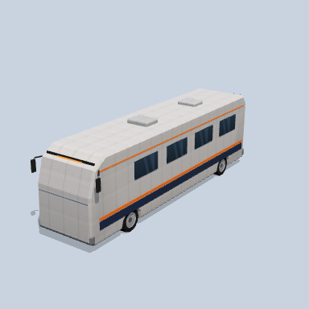 | **Motorhome da equipe**<br>[`motorhome.glb`](modelos/motorhome.glb) | Motorhome com faixas da equipe | 3.496 | 3,4 m × 3,7 m × 11,4 m | 463,6 KB |
| 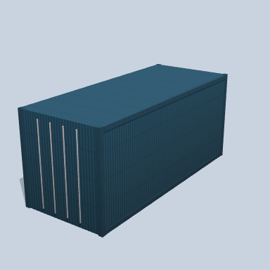 | **Contêiner**<br>[`conteiner.glb`](modelos/conteiner.glb) | Contêiner de carga de 6 m | 188 | 2,5 m × 2,6 m × 6,1 m | 29,5 KB |
| 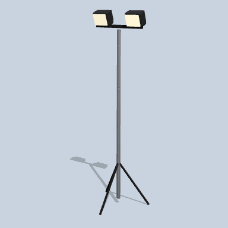 | **Torre de holofote**<br>[`holofote.glb`](modelos/holofote.glb) | Holofote em tripé com a lâmpada acesa | 432 | 98 cm × 3,4 m × 86 cm | 60,6 KB |
| 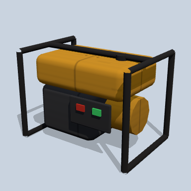 | **Gerador**<br>[`gerador.glb`](modelos/gerador.glb) | Gerador portátil sobre rodas | 744 | 84 cm × 63 cm × 59 cm | 99,5 KB |
| 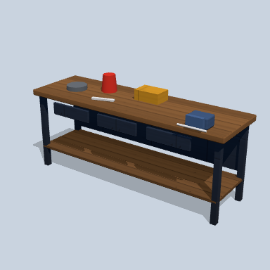 | **Bancada de trabalho**<br>[`bancada.glb`](modelos/bancada.glb) | Bancada de oficina com gavetas | 932 | 2,4 m × 1,2 m × 79 cm | 127,6 KB |
|  | **Painel de ferramentas**<br>[`painel_de_ferramentas.glb`](modelos/painel_de_ferramentas.glb) | Painel de parede com ferramentas penduradas | 316 | 2,4 m × 1,2 m × 7 cm | 45,3 KB |
|  | **Carrinho de ferramentas**<br>[`caixa_de_ferramentas.glb`](modelos/caixa_de_ferramentas.glb) | Carrinho de ferramentas alto com gavetas | 1.232 | 79 cm × 1,1 m × 53 cm | 162,4 KB |
|  | **Macaco jacaré**<br>[`macaco_jacare.glb`](modelos/macaco_jacare.glb) | Macaco hidráulico de oficina | 420 | 38 cm × 74 cm × 1,7 m | 57,7 KB |
|  | **Extintor**<br>[`extintor.glb`](modelos/extintor.glb) | Extintor de incêndio | 208 | 21 cm × 65 cm × 20 cm | 28,3 KB |
|  | **Cadeira dobrável**<br>[`cadeira_dobravel.glb`](modelos/cadeira_dobravel.glb) | Cadeira de lona dobrável | 136 | 63 cm × 93 cm × 59 cm | 22,0 KB |
|  | **Mesa dobrável**<br>[`mesa_dobravel.glb`](modelos/mesa_dobravel.glb) | Mesa leve de apoio | 376 | 1,2 m × 1,1 m × 70 cm | 52,0 KB |
|  | **Tambor de óleo**<br>[`tambor.glb`](modelos/tambor.glb) | Tambor metálico de 200 litros | 216 | 60 cm × 91 cm × 60 cm | 31,4 KB |
|  | **Galão de combustível**<br>[`galao.glb`](modelos/galao.glb) | Galão de combustível | 336 | 18 cm × 50 cm × 34 cm | 46,9 KB |
|  | **Pallet com caixas**<br>[`pallet_com_caixas.glb`](modelos/pallet_com_caixas.glb) | Pallet de madeira com caixas de papelão | 420 | 1,2 m × 56 cm × 1,0 m | 58,4 KB |
|  | **Saco de areia**<br>[`saco_de_areia.glb`](modelos/saco_de_areia.glb) | Saco de areia de lastro | 42 | 40 cm × 14 cm × 25 cm | 9,2 KB |
|  | **Pilha de pneus**<br>[`pilha_de_pneus.glb`](modelos/pilha_de_pneus.glb) | Pilha de quatro pneus | 744 | 69 cm × 98 cm × 66 cm | 101,5 KB |
|  | **Cone**<br>[`cone.glb`](modelos/cone.glb) | Cone de sinalização | 148 | 36 cm × 64 cm × 36 cm | 20,5 KB |
|  | **Cerca de grade**<br>[`cerca_de_grade.glb`](modelos/cerca_de_grade.glb) | Lance de cerca de grade com faixa amarela | 60 | 4,0 m × 1,1 m × 10 cm | 14,8 KB |

## Pastas

- `modelos/<id>.glb`: um modelo por arquivo.
- `texturas/`: as 9 texturas de 64×64 px do kit (as mesmas que vão dentro dos `.glb`; as placas com texto ficam só dentro dos modelos).
- `previas/<id>.png`: vista três-quartos de cada modelo.
- `catalogo.json`: seções, modelos, descrições, medidas, triângulos, materiais e caminhos dos arquivos.
- `docs/`: mosaico geral, mosaicos por seção e a capa.

## Como usar os modelos

- Metros, eixo Y para cima, frente em +Z. A origem fica no chão: no centro do quarteirão nos locais, no centro do lote nos prédios e casas, e no centro do objeto nas peças soltas.
- As cores estão na cor por vértice (com a base escurecida perto do chão, como luz ambiente assada); as texturas são cinza e só dão o grão. Ligue a cor por vértice no material se o seu programa não ligar sozinho.
- Os materiais `luz` (janelas acesas, lâmpadas, faróis) e `placa` são sem iluminação: brilham iguais de dia e de noite.
- Os locais têm as placas com texto em português ("MUSEU DO RALI", "SEMINOVOS"...): troque a textura `placa` para traduzir.

Exemplo em JavaScript, com o carregador de glTF da sua biblioteca web 3D:

```js
const museu = (await carregadorGltf.loadAsync("modelos/museu_do_rali.glb")).scene;
museu.traverse((o) => { if (o.isMesh) o.material.vertexColors = true; });
cena.add(museu);
```

## Perguntas frequentes

**Em que formato estão os modelos?**
Em glTF 2.0 binário (`.glb`), um arquivo por modelo, com malha, materiais e texturas embutidos. As texturas do kit também estão soltas em PNG.

**Posso importar em qualquer motor de jogo ou programa 3D?**
Sim, em qualquer motor, biblioteca web ou editor 3D que leia glTF 2.0. A única extensão usada é a de material sem iluminação, que todos os leitores de glTF conhecem.

**As marcas das concessionárias existem?**
Não. As cinco marcas, com nomes, cores e logotipos, foram inventadas para o jogo; nenhuma imita fabricante real.

**Posso usar num jogo comercial?**
Sim. Os modelos estão em domínio público (CC0 1.0): use, modifique e redistribua sem pedir licença nem dar crédito. O crédito é bem-vindo (veja [`CITATION.cff`](CITATION.cff)).

**Como foram feitos?**
Por código: cada modelo é montado a partir de caixas chanfradas, cilindros, tubos e perfis extrudados, com cor por vértice e texturas de 64 px desenhadas em canvas, pelo mesmo código que desenha a cidade e o parque de apoio no jogo. Cada arquivo foi exportado, aberto de novo e desenhado para conferir.

## Outras coleções do mesmo jogo

- [Frota de carros de rali](https://github.com/kayquer/scitizia-frota-64) · [Props quebráveis](https://github.com/kayquer/scitizia-props-64) · [Pessoas](https://github.com/kayquer/scitizia-pessoas-64) · [Rodas e pneus](https://github.com/kayquer/scitizia-rodas-64) · [Peças de carro](https://github.com/kayquer/scitizia-pecas-64) · [Natureza](https://github.com/kayquer/scitizia-natureza-64)

## Licença

[CC0 1.0 Universal](LICENSE): domínio público.

## Como citar

Os metadados de citação estão em [`CITATION.cff`](CITATION.cff).
